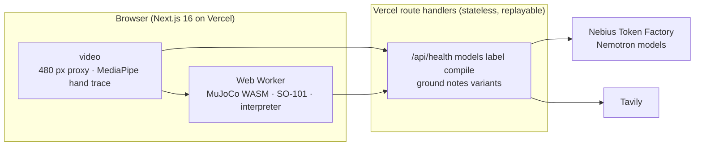

<h1 align="center">Understudy</h1>

<p align="center"><b>Watch a person do a task once. Ask them what the camera could not see. Rehearse it on a simulated robot, on Earth and in orbit, and fix what fails.</b></p>

<p align="center">
  <a href="https://understudy-rose.vercel.app"><b>Live demo</b></a> ·
  <a href="https://youtu.be/G0QQybVRwtQ"><b>Video (2:57)</b></a> ·
  <a href="docs/SPEC.md">Spec</a> ·
  <a href="docs/PLAN.md">Plan</a> ·
  <a href="docs/LIMITATIONS.md">What it proves and does not</a> ·
  <a href="docs/SUBMIT.md">Submission</a> ·
  <a href="docs/FEEDBACK.md">Feedback on Nebius and NVIDIA tools</a>
</p>

---

> **Status (29 October 2026):** the site at [understudy-rose.vercel.app](https://understudy-rose.vercel.app) does what the "Built" table below lists, on Nebius Token Factory, and answers from its recordings with no key, past the spend guard, or when Token Factory stops listing a model it calls. What is designed but not on the site yet is listed under "Next", with no date. The task board is the GitHub issues, tracker [#45](https://github.com/gibouu/understudy/issues/45). Built for the [Nebius x NVIDIA Global AI Hackathon](https://nebiusglobalaihackathon.devpost.com/), Physical AI track.

An understudy learns a role by watching the lead, then rehearses it on stage. Understudy does that for robots. One phone clip of a person doing a tabletop task goes in. A vision model says what it saw; a second model writes the robot's program and turns every number it would have to guess into a question for the person; a simulated arm rehearses the answered program on Earth and in orbit; and when a rehearsal fails, the simulator's notes go back to the model, which patches the program until it passes, up to five patches. The patches, the similar tasks and the recorded sessions show what their model calls cost.

## Why

On a space station every crew hour is scarce and every mistake is expensive: NASA prices an hour of ISS crew time at $130,000 for commercial activities, and the station costs it about $3 billion a year. The robots meant to take over routine crew work (Canadarm2 and Dextre, Astrobee, GITAI's arm on the ISS, the arms planned for commercial stations and lunar bases) need three things a station already produces by the hour: a clear task, a rehearsed program, and labelled data. NASA films crew procedures all the time. Understudy turns one such clip into the first two, and rehearses the result under Earth gravity and in orbit, because a program that works on a bench can fail the moment a released object drifts instead of resting. The same loop serves satellite servicing and refuelling, where the stakes are a spacecraft rather than a sample.

The need is the same on the ground. Teaching a robot is expensive: NVIDIA's GR00T N1 took about 50,000 H100 GPU-hours to pretrain, and Physical Intelligence's pi0 more than 10,000 hours of robot data. Collecting human demonstrations is an industry now, and the waste comes after collection. In DROID about one recorded trajectory in six was marked failed, and one vendor's cost model puts re-collection after the first policy evaluation at 30 to 50 percent of the original budget. Nobody asks the person who did the task what mattered. Understudy is the briefing and QA layer in front of collection, on a lab bench or on a station: *what exactly is this task*, and *can a robot program do it, on the ground and in orbit*.

| What | Number | Source |
|---|---|---|
| NASA's reimbursable value of one hour of ISS crew time, commercial activities | $130,000 | [NASA pricing policy](https://www.nasa.gov/leo-economy/commercial-use/pricing-policy/) |
| What the ISS costs NASA a year | about $3 billion, a third of its human spaceflight budget | [NASA OIG, IG-22-005](https://oig.nasa.gov/docs/IG-22-005.pdf) |
| Compute to pretrain NVIDIA's GR00T N1 | about 50,000 H100 GPU-hours | [GR00T N1 paper](https://arxiv.org/html/2503.14734) |
| Synthetic data for GR00T N1 | 780,000 trajectories, worth 6,500 human hours, made in 11 hours | [GR00T N1 paper](https://arxiv.org/html/2503.14734) |
| DROID trajectories marked failed at recording | about 1 in 6 | [DROID paper](https://arxiv.org/html/2403.12945v2) |
| Re-collection after the first policy evaluation (one vendor's model) | 30 to 50% of the original budget | [Robotics Center](https://roboticscenter.ai/blog/robot-data-collection-cost) |
| A recorded session in the space showcase (label, program, answers, patches) | 1 to 7 calls, $0.0007 to $0.0059 | [public/showcase/](public/showcase/) |
| Failing rehearsals fixed by the model from simulator notes, on small probe programs | 94% of solvable failures (91% of all) within 5 patches, $0.0024 per fixed case | [docs/MEASUREMENTS.md](docs/MEASUREMENTS.md) |

The full brief, with the cost model for a 500-demonstration campaign and all 43 sources, is in [docs/research/market.md](docs/research/market.md).

## Where this comes from

Understudy was a month of internal research before it was a hackathon project. The question we kept coming back to: everyone films people doing tasks to train robots, so why is so much of that footage never used, and what would a buyer need to know before paying for five hundred more repetitions? The answer we converged on is a loop: ask the person who did the task, rehearse the clarified task in simulation under perturbation, and report what a robot would need to perceive to do it. This repository implements the asking, the rehearsal on Earth and in orbit, and a repair loop around it; the perturbation grid and the perception report are next. The notes behind that design are in [docs/research/](docs/research/). The hackathon week, 23 to 30 October 2026, is where the research became working software on Nebius Token Factory with NVIDIA's Nemotron models.

## What it does

Three pages, linked from the home page (`/`): the **1-minute demo** (`/demo`) walks through one recorded run step by step and ends with its export, **Try it** (`/try`) runs a sample clip or one of your own through the stages below, and the **space showcase** (`/space`, one page per clip at `/space/<clip>`) plays recorded runs of NASA clips with no model call. Two pages are not linked from the menu: `/stage`, the rehearsal stage on its own (Earth, the Moon or orbit, an object to nudge), and `/watch`, a development page that runs MediaPipe on a sample clip.

### Built: on the site today

| Stage | What happens | Runs on |
|---|---|---|
| **Watch** | The clip stays in the browser; only a small proxy of it (480 px wide, 4 fps) is sent to the model. For a gesture, such as a wave, MediaPipe traces the hand in the browser and the arm follows that path. | browser, MediaPipe |
| **Label** ("What the model saw") | The proxy becomes a task spec: steps with timestamps, objects as primitives with size and symmetry, each target a `pocket`, `zone` or `stack`, then fitted to the robot's bench. | `nvidia/Nemotron-3.5-Super-VL` on Nebius Token Factory |
| **Questions from the robot** | The spec becomes a robot program: `move_to`, `grasp`, `release`, `wait_until`, `assert`. Every value the compiler would have to guess becomes an `ask` slot, shown as a question answered with a number, a choice or chips. Each answer patches the spec, and the program recompiles. | `nvidia/NVIDIA-Nemotron-3-Nano-30B-A3B` in the recordings; `nvidia/Nemotron-3_5-Lightning` live |
| **Ground** (opt-in) | Advice for the task found on the web, as chips with their source URLs. | Tavily search + extract, filtered by the compiling model |
| **Rehearse** | A simulated SO-101 arm runs the program in MuJoCo, in the browser, under Earth gravity (1 g) and in orbit (0 g), with the object's pose known to the program. | `@mujoco/mujoco` WebAssembly in a Web Worker |
| **Notes** | When a rehearsal fails, the simulator's failure note goes to the model as text; it returns one patch, the route clamps and applies it, and the arm runs again, up to five patches. Thinking stays off until the loop is stuck (a patch that changes nothing, or two failed patches). | `nvidia/nemotron-3-super-120b-a12b` in the recordings, thinking when stuck; live, `nvidia/Nemotron-3.5-Super-VL`, handing a stuck loop to `nvidia/Nemotron-3-Ultra-550b-a55b` |
| **Try a similar task** | The model suggests similar tasks, or writes one from a line you type; each is checked against the bench, compiled and rehearsed on Earth and in orbit, and an idea the arm cannot do yet comes back with the reason. | Super (Super VL live), then the compiling model |
| **Space showcase** | NASA clips from the ISS, each one recorded run: what the model saw, what the robot asked, and "How it improved", one row per version of the program (first compile, after the answers, each Notes patch). The arm rehearses every version again in your browser. | recordings, browser |
| **Export** (1-minute demo only) | The demo's last step builds `understudy-<sample>.zip` in the browser from the Earth and orbit rollouts it just played: a LeRobot v2.1 skeleton in the layout Isaac-GR00T N1.7 reads: `meta/info.json`, `modality.json` and one parquet file per passing rollout, with joint states and actions in radians at 15 fps and no video, plus `QUALITY.md` and the run's spec, program, interview, versions and ledger. It is format-valid, not checked with GR00T's loader, and not training data. | `lib/export/`, browser |
| **Cost** | Priced at Token Factory's list prices (`GET /v1/models?verbose=true`): each Notes patch shows its tokens and price, the similar tasks show each call's price and their total, and each showcase run shows the price of every version of its program and of the whole session. The section titles on Try it name the model that answered. | browser |

### Next: designed, not on the site yet

- **Perturbation grid (the "saboteur" of the spec):** twelve perturbation scenarios chosen from object symmetry and the tightest constraint, each run **blind** (nominal object pose) and **sensed** (perturbed pose known), giving the **perception budget**: per axis and per gravity, how much pose error the task survives without perception and with it. The simulator takes both modes; the site runs sensed only.
- **Scoreboard and playbook:** every version scored on the same 24 rollouts against a retarget-and-replay baseline ([#55](https://github.com/gibouu/understudy/issues/55)), and patches that fixed a failure carried to the next clip as rules ([#56](https://github.com/gibouu/understudy/issues/56)).
- **Reshoot list:** failure classes (spec gap, footage gap, embodiment limit, simulator artefact), a reshoot list and open risks, from Nemotron 3 Ultra.
- **Export from Try it, with video:** Try it has no export, and the demo's export holds no video. The writer in [lib/export/](lib/export/) can add an MP4 per episode, and no export has been loaded by GR00T's loader yet.
- **The Moon on Try it:** the Moon preset (0.1654 g) is in the contract and on the `/stage` page; Try it rehearses on Earth and in orbit.

Task-agnostic by construction: the code never names a task. The sample clips are NASA public-domain footage from the ISS, in [samples/](samples/README.md): an astronaut placing seed film into the plant pillows of the station's Veggie facility (the hero clip, filmed in microgravity), a second seed film clip, a pipette into a sample cartridge in a glovebox, a drink bag squeezed into foam, a chess match, and a wave.

## Orbit mode

Gravity is a scenario axis. The contract carries `gravity_g` on every rollout, and Try it rehearses every program at 1 g and at 0 g; the `/stage` page also has the Moon (0.1654 g) and an object to nudge. On Earth a released object rests where it was put; in orbit it keeps drifting, so a program that passed on the bench fails in orbit unless it holds the object until it is constrained, and the Notes loop has to find that patch. What it proves and does not: rigid-body physics with gravity set to zero, no air currents, tethers, cable drag or flight rules; a drifting object is a model, not a flight test.

## Which model does what, and why that tier

| Job | In the recordings | Live, since 27 October | Why this tier |
|---|---|---|---|
| watches the video proxy, labels segments, objects, sizes, symmetry | `nvidia/Nemotron-3.5-Super-VL` | `nvidia/Nemotron-3.5-Super-VL` | the hosted NVIDIA model that takes images and video |
| compiles the spec to a program after every answer, with a question for every value it would guess; filters grounding; health probe | `nvidia/NVIDIA-Nemotron-3-Nano-30B-A3B` | `nvidia/Nemotron-3_5-Lightning` | fast and cheap, called most often |
| proposes the Notes patches; suggests similar tasks | `nvidia/nemotron-3-super-120b-a12b`, thinking once the loop is stuck | `nvidia/Nemotron-3.5-Super-VL`, thinking off | reasoning when it is needed, off when it is not |
| answers a stuck patch loop (a patch that changes nothing, or two failed patches) | not in the recordings | `nvidia/Nemotron-3-Ultra-550b-a55b`, thinking off | Super VL cannot think within the patch budget, so the largest model takes the failures the cheap pass could not fix |

Token Factory retires Nano and Super from Serverless on 9 November 2026 ([its notice](https://docs.tokenfactory.nebius.com/model-deprecations-november-2026)), before judging ends. The ISS examples are recordings made on Nano and Super; since 27 October a clip of your own runs on the replacements Token Factory names, `nvidia/Nemotron-3_5-Lightning` in Nano's place and `nvidia/Nemotron-3.5-Super-VL` in Super's, measured on the same benches (`docs/MEASUREMENTS.md` section 12). If Token Factory stops listing a model the routes call, every step replays its recording and says why.

Every call goes through the OpenAI SDK with `base_url` set to `https://api.tokenfactory.nebius.com/v1/`; the prices on the page (patches, similar tasks, showcase sessions) come from `GET /v1/models?verbose=true`, and the label and compile calls on Try it name their model but show no price. The recorded showcase sessions made 1 to 7 calls each and cost $0.0007 to $0.0059 ([public/showcase/](public/showcase/)). A fuller session, measured on 25 October with prototype prompts for every planned stage, the saboteur and Ultra's reshoot list included, made 16.7 calls and cost $0.0375, three quarters of it the reshoot list (`docs/MEASUREMENTS.md` section 1).

Other Nebius services: none behind the site. A LoRA stand-in was trained with Token Factory fine-tuning and has no measured result yet ([docs/FINETUNE.md](docs/FINETUNE.md)).

## Architecture



## Setup

```bash
git clone https://github.com/gibouu/understudy && cd understudy
pnpm install
cp .env.example .env.local        # add NEBIUS_API_KEY (and TAVILY_API_KEY); without a key the app answers from its recordings
pnpm dev                           # http://localhost:3000
pnpm test && pnpm typecheck && pnpm lint
```

Without `.env.local`, `pnpm dev` runs and `/api/health` answers `{"mode":"replay","reason":"no NEBIUS_API_KEY"}`: every stage answers from its recording. With a key and `UNDERSTUDY_UNLOCK_CODE` unset, local dev calls Token Factory without asking for the code. `pnpm test` takes two to four minutes (the rehearsal tests step MuJoCo) and never calls a model. The model IDs can be overridden from env (`UNDERSTUDY_MODEL_*` in `.env.example`); a retired ID is replaced by its successor unless `UNDERSTUDY_KEEP_RETIRED=1`.

Credits for the hackathon: promo code `NEBIUS-DEVPOST-GLOBAL26` on Token Factory, plus the Nebius Builder Program (more Token Factory and Tavily credits). Both need a card on the account.

## Testing instructions for judges

Chrome on a laptop, at [understudy-rose.vercel.app](https://understudy-rose.vercel.app). No account and no key are needed.

1. **Watch the 1-minute demo** (`/demo`): one recorded NASA run, step by step, with the arm rehearsing live in the browser and no model call. The last step downloads that run as a LeRobot v2.1 skeleton (joint values, no video; format-valid, not checked with GR00T's loader, not training data).
2. **Space showcase** (`/space`): open a clip to see what the model saw, what the robot asked and how the program improved; the arm rehearses every version again in the browser. No model call, so it works whatever the state of the credits.
3. **Try it** (`/try`): pick a sample clip. It answers from its recording where it has one and live otherwise, and each section names the model that answered. The answers given when it was recorded are filled in: click "Answer and recompile", then "Rehearse on Earth, then in orbit". When a rehearsal fails, the Notes patches appear one by one, with their price. Uploading a clip of your own needs the unlock code given in the submission (H.264 MP4, one person, fixed phone).

A live call that Token Factory refuses shows as failed on the page.

## How it improves

Every version of the program is rehearsed again, on Earth and in orbit, and priced. In the space showcase, "How it improved" lists each version of a recorded run: the first compile, the program after the answers, and each Notes patch, with what its rehearsal showed and what it cost. No policy is trained here; the simulator is the reward signal and the model is the policy editor. Next, with no date: scoring every version on the same 24 rollouts against the human trajectory retargeted and replayed ([#55](https://github.com/gibouu/understudy/issues/55)), and turning patches that fixed a failure into rules the next clip starts from ([#56](https://github.com/gibouu/understudy/issues/56)).

The loop itself is measured on the bench harness, on small probe programs of two to four knobs ([docs/MEASUREMENTS.md](docs/MEASUREMENTS.md), section 8): four tasks (insert, place, pour, carry under acceleration) at Earth, Mars, Moon and orbit gravity with disturbances. A naive, human-like program fails 86% of the runs. From the simulator's failure notes alone, Nemotron Super with thinking off fixes 69% within five patches; escalating to reasoning when it gets stuck fixes 94% of the solvable failures (95% interval 89 to 97%; 91% of all failures), at $0.0024 per fixed case. In that harness, rules learned on Earth and Mars make the first try on the Moon and in orbit right more often: +28 points with the cheap model (5% to 33%) and +18 with reasoning (48% to 67%), each against a matched control; within five patches the loop gets there with or without them. The site has no playbook yet, so this is a measurement, not a feature.

## Simulated versus real

The rehearsal proves that the clarified spec is executable by a scripted SO-101 program across the stated band, in rigid-body physics with a geometric grasp, and that its success criteria are computable. On the site today the band is the nominal layout at 1 g and 0 g; the perturbation band is next. It does not prove a learned policy would succeed or that a real grasp holds. The 1-minute demo's export is a format-valid LeRobot skeleton of the rollouts it played (joint values, no video), not training data, and its quality report says so. Details: [docs/LIMITATIONS.md](docs/LIMITATIONS.md) (three documented failing rollouts land with issue #24).

## Prior art

Every piece exists somewhere: in-browser pose (MediaPipe), video to task plan with vision-language models (GPT-4V for Robotics, SeeDo), few demos to many (MimicGen, DexMimicGen, GR00T-Mimic), human video to humanoid imitation (OKAMI), sim data at scale (GR00T-Dreams). What is new is the loop and its measurement: a cheap model plays the robot and what it would have to guess becomes the interview; every answer is recorded as the source of the field it changed; the simulator rehearses the answered program on Earth and in orbit; and its failure notes go back to the model as text until a patch passes, up to five patches. Next, not built: a reasoning model turning the answers into falsifying scenarios, run blind and sensed, for a perception requirement per axis, and a reshoot list. The research behind these claims, with sources: [docs/research/](docs/research/).

## Team

gib, Cam Cunningham, Leah. Paris, Builders and Brews.

## License

Apache-2.0. The SO-101 model comes from [MuJoCo Menagerie](https://github.com/google-deepmind/mujoco_menagerie) (Apache-2.0); MediaPipe and MuJoCo are Apache-2.0.
