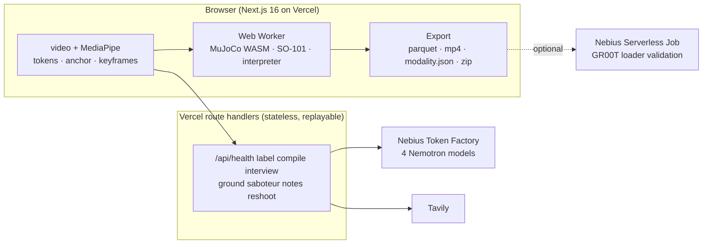

<h1 align="center">Understudy</h1>

<p align="center"><b>Watch a person do a task once. Interview them. Rehearse it on a simulated robot. Export the training data.</b></p>

<p align="center">
  <a href="docs/SPEC.md">Spec</a> ·
  <a href="docs/PLAN.md">Plan</a> ·
  <a href="docs/LIMITATIONS.md">What it proves and does not</a> ·
  <a href="docs/SUBMIT.md">Submission</a> ·
  <a href="docs/FEEDBACK.md">Feedback on Nebius and NVIDIA tools</a>
</p>

---

> **Status, day one of seven (23 October 2026):** repository, shared contract, docs and task board. The stages below are the design; each one links to its issue until it ships. Built for the [Nebius x NVIDIA Global AI Hackathon](https://nebiusglobalaihackathon.devpost.com/), Physical AI track.

An understudy learns a role by watching the lead, then rehearses it on stage. Understudy does that for robots. One phone clip of a person doing a tabletop task goes in; what comes out is a task spec the person has been interviewed about, a robot program that a simulated arm has rehearsed under perturbation, one number per axis saying how much pose error the task tolerates, a reshoot list, and a dataset skeleton in the layout GR00T reads.

## Why

Collecting human demonstrations is an industry now: recorders at about $15 an hour, data factories, teleoperation farms. The waste comes after collection: a fifth to a third of demos get discarded, re-collection eats a third to a half of a campaign budget, and nobody asks the person who did the task what mattered. Understudy is the briefing and QA layer in front of collection. It answers two questions before anyone buys five hundred repetitions: *what exactly is this task*, and *what does a robot need to perceive to do it*.

## What it does

| Stage | What happens | Runs on |
|---|---|---|
| **Watch** | Pose and hand landmarks become motion tokens drawn over the clip; the grasp moment becomes the anchor; 12 to 16 keyframes are picked. Nothing but those keyframes leaves the browser. | browser, MediaPipe |
| **Label** | Keyframes become a task spec: steps with timestamps, objects as primitives with size and symmetry, each target as a `pocket`, `zone` or `stack`. | `nvidia/Nemotron-3.5-Super-VL` on Nebius Token Factory |
| **Compile** | The spec becomes a robot program: `move_to`, `grasp`, `release`, `wait_until`, `assert`. Whatever the compiler cannot execute becomes an `ask` slot. | `nvidia/NVIDIA-Nemotron-3-Nano-30B-A3B` |
| **Interview** | The `ask` slots are the questionnaire. Each question cites a measurement from this clip; each answer patches the spec and the program recompiles. | `nvidia/nemotron-3-super-120b-a12b` |
| **Ground** (opt-in) | Hazards and preconditions for the task, with their source URLs. | Tavily search + extract, filtered by Nano |
| **Saboteur** | Twelve perturbation scenarios chosen from object symmetry and the tightest constraint, each with an expected outcome. | `nvidia/nemotron-3-super-120b-a12b` |
| **Rehearsal** | A simulated SO-101 arm runs the program in MuJoCo, in the browser, once per scenario in two modes: **blind** (nominal object pose) and **sensed** (perturbed pose known). The result is the **perception budget**: per axis, how far the task survives without perception and with it. | `@mujoco/mujoco` WebAssembly in a Web Worker |
| **Notes** | The worst failure goes back to the model as text; it proposes one patch; the program recompiles and re-runs. | Super, then Nano |
| **Reshoot** | Failure classes (spec gap, footage gap, embodiment limit, simulator artefact), a reshoot list and open risks. | `nvidia/Nemotron-3-Ultra-550b-a55b`, in the background |
| **Export** | `understudy-<task>.zip`: a LeRobot v2.1 dataset skeleton with `modality.json` (the layout Isaac-GR00T N1.7 reads), the spec with per-field provenance, the interview transcript, the rehearsal report, the reshoot list, the cost ledger and a quality report that says plainly what the data is. | browser |

Task-agnostic by construction: the code never names a task. Three sample clips ship with the app to prove it: a capped marker from a tray into a cardboard rack (a stand-in for a lab tube rack), a cup onto a saucer, a small box onto a shelf.

## Which model does what, and why that tier

| Model on Nebius Token Factory | Job | Why this tier |
|---|---|---|
| `nvidia/Nemotron-3.5-Super-VL` | watches keyframes, labels segments, objects, sizes, symmetry | the hosted NVIDIA model that takes images and video |
| `nvidia/NVIDIA-Nemotron-3-Nano-30B-A3B` | compiles the spec to a program after every answer; filters grounding; health probe | fast and cheap, called most often |
| `nvidia/nemotron-3-super-120b-a12b` | interviews, writes the saboteur scenarios, proposes patches | reasoning with chips streamed as they close |
| `nvidia/Nemotron-3-Ultra-550b-a55b` | failure classes, reshoot list, open risks | the deep pass, once per session, in the background |

Every call goes through the OpenAI SDK with `base_url` set to `https://api.tokenfactory.nebius.com/v1/`. A session makes about 18 requests and costs under ten cents. The cost ledger on screen prices them from `GET /v1/models?verbose=true`.

Other Nebius services: a Serverless Job (`jobs/validate_groot.py`) loads a real export with Isaac-GR00T's dataset loader and the log goes here when it has run.

## Architecture



## Setup

```bash
git clone https://github.com/gibouu/understudy && cd understudy
pnpm install
cp .env.example .env.local        # add NEBIUS_API_KEY (and TAVILY_API_KEY); without a key every route replays recorded sessions
pnpm dev                           # http://localhost:3000
pnpm test && pnpm typecheck && pnpm lint
```

Credits for the hackathon: promo code `NEBIUS-DEVPOST-GLOBAL26` on Token Factory, plus the Nebius Builder Program (more Token Factory and Tavily credits). Both need a card on the account.

## Simulated versus real

The rehearsal proves that the clarified spec is executable by a scripted SO-101 program across the stated band, in rigid-body physics with a geometric grasp, and that its success criteria are computable. It does not prove a learned policy would succeed or that a real grasp holds. The export is a format-valid skeleton for GR00T's loader, not training data, and its quality report says so. Details and three documented failing rollouts: [docs/LIMITATIONS.md](docs/LIMITATIONS.md).

## Prior art

Every piece exists somewhere: in-browser pose (MediaPipe), video to task plan with vision-language models (GPT-4V for Robotics, SeeDo), few demos to many (MimicGen, DexMimicGen, GR00T-Mimic), human video to humanoid imitation (OKAMI), sim data at scale (GR00T-Dreams). What is new is the loop and its measurement: a cheap model plays the robot and its compile errors are the interview; the answers become tolerance bands; a reasoning model turns bands into falsifying scenarios; the simulator runs them blind and sensed; the output is a perception requirement per axis, a spec with provenance on every field, and a reshoot list. The research behind these claims, with sources: [docs/research/](docs/research/).

## Team

gib, Cam Cunningham, Leah. Paris, Builders and Brews.

## License

Apache-2.0. The SO-101 model comes from [MuJoCo Menagerie](https://github.com/google-deepmind/mujoco_menagerie) (Apache-2.0); MediaPipe and MuJoCo are Apache-2.0.
