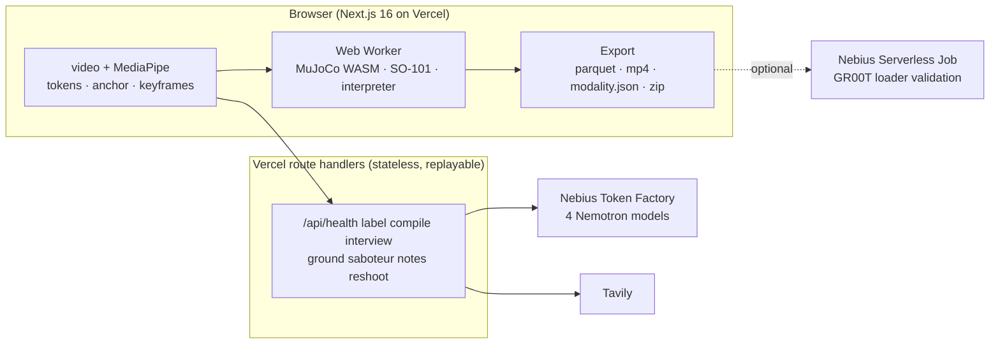

<h1 align="center">Understudy</h1>

<p align="center"><b>Watch a person do a task once. Interview them. Rehearse it on a simulated robot, on Earth and in orbit. Export the dataset.</b></p>

<p align="center">
  <a href="docs/SPEC.md">Spec</a> ·
  <a href="docs/PLAN.md">Plan</a> ·
  <a href="docs/LIMITATIONS.md">What it proves and does not</a> ·
  <a href="docs/SUBMIT.md">Submission</a> ·
  <a href="docs/FEEDBACK.md">Feedback on Nebius and NVIDIA tools</a>
</p>

---

> **Status (hackathon week, 23 to 30 October 2026):** the rehearsal stage, the watch page, the shared contract, the scene builder and the LeRobot export writer are merged; the Token Factory path is live and its behaviour measured (`docs/FEEDBACK.md`). The label, compile, interview, saboteur and notes routes are the week's remaining work; the task board is the GitHub issues, tracker [#45](https://github.com/gibouu/understudy/issues/45). Built for the [Nebius x NVIDIA Global AI Hackathon](https://nebiusglobalaihackathon.devpost.com/), Physical AI track.

An understudy learns a role by watching the lead, then rehearses it on stage. Understudy does that for robots. One phone clip of a person doing a tabletop task goes in; what comes out is a task spec the person has been interviewed about, a robot program that a simulated arm has rehearsed under perturbation, one number per axis saying how much pose error the task tolerates, a reshoot list, and a dataset skeleton in the layout GR00T reads.

## Why

On a space station every crew hour is scarce and every mistake is expensive: NASA prices an hour of ISS crew time at $130,000 for commercial activities, and the station costs it about $3 billion a year. The robots meant to take over routine crew work (Canadarm2 and Dextre, Astrobee, GITAI's arm on the ISS, the arms planned for commercial stations and lunar bases) need three things a station already produces by the hour: a clear task, a rehearsed program, and labelled data. NASA films crew procedures all the time. Understudy turns one such clip into all three, and rehearses the result under Earth gravity and in orbit, because a program that works on a bench can fail the moment a released object drifts instead of resting. The same loop serves satellite servicing and refuelling, where the stakes are a spacecraft rather than a sample.

The need is the same on the ground. Teaching a robot is expensive: NVIDIA's GR00T N1 took about 50,000 H100 GPU-hours to pretrain, and Physical Intelligence's pi0 more than 10,000 hours of robot data. Collecting human demonstrations is an industry now, and the waste comes after collection. In DROID about one recorded trajectory in six was marked failed, and one vendor's cost model puts re-collection after the first policy evaluation at 30 to 50 percent of the original budget. Nobody asks the person who did the task what mattered. Understudy is the briefing and QA layer in front of collection, on a lab bench or on a station: *what exactly is this task*, and *what does a robot need to perceive to do it*.

| What | Number | Source |
|---|---|---|
| NASA's reimbursable value of one hour of ISS crew time, commercial activities | $130,000 | [NASA pricing policy](https://www.nasa.gov/leo-economy/commercial-use/pricing-policy/) |
| What the ISS costs NASA a year | about $3 billion, a third of its human spaceflight budget | [NASA OIG, IG-22-005](https://oig.nasa.gov/docs/IG-22-005.pdf) |
| Compute to pretrain NVIDIA's GR00T N1 | about 50,000 H100 GPU-hours | [GR00T N1 paper](https://arxiv.org/html/2503.14734) |
| Synthetic data for GR00T N1 | 780,000 trajectories, worth 6,500 human hours, made in 11 hours | [GR00T N1 paper](https://arxiv.org/html/2503.14734) |
| DROID trajectories marked failed at recording | about 1 in 6 | [DROID paper](https://arxiv.org/html/2403.12945v2) |
| Re-collection after the first policy evaluation (one vendor's model) | 30 to 50% of the original budget | [Robotics Center](https://roboticscenter.ai/blog/robot-data-collection-cost) |
| An Understudy session, measured on Token Factory | 16.7 calls, $0.0375 on average ($0.028 to $0.052), 71 s | [docs/MEASUREMENTS.md](docs/MEASUREMENTS.md) |
| Failing rehearsals fixed by the model from simulator notes | 94% of solvable failures (91% of all) within 5 patches, $0.0024 per fixed case | [docs/MEASUREMENTS.md](docs/MEASUREMENTS.md) |

The full brief, with the cost model for a 500-demonstration campaign and all 43 sources, is in [docs/research/market.md](docs/research/market.md).

## Where this comes from

Understudy was a month of internal research before it was a hackathon project. The question we kept coming back to: everyone films people doing tasks to train robots, so why is so much of that footage never used, and what would a buyer need to know before paying for five hundred more repetitions? The answer we converged on is the loop this repository implements: ask the person who did the task, rehearse the clarified task in simulation under perturbation, and report what a robot would need to perceive to do it. The notes behind that design are in [docs/research/](docs/research/). The hackathon week, 23 to 30 October 2026, is where the research became working software on Nebius Token Factory with NVIDIA's Nemotron models.

## What it does

| Stage | What happens | Runs on |
|---|---|---|
| **Watch** | Pose and hand landmarks become motion tokens drawn over the clip; the grasp moment becomes the anchor; a 480p proxy is encoded. Station cameras are far and crews wear gloves, which the hand model cannot see, so a sepia-toned crop around each wrist gets a second look. Nothing but that proxy leaves the browser. | browser, MediaPipe |
| **Label** | A small video proxy of the clip (480p, 4 fps, about 150 KB per 30 s) becomes a task spec: steps with timestamps, objects as primitives with size and symmetry, each target as a `pocket`, `zone` or `stack`. Keyframes are the fallback. | `nvidia/Nemotron-3.5-Super-VL` on Nebius Token Factory |
| **Compile** | The spec becomes a robot program: `move_to`, `grasp`, `release`, `wait_until`, `assert`. Whatever the compiler cannot execute becomes an `ask` slot. | `nvidia/NVIDIA-Nemotron-3-Nano-30B-A3B` |
| **Interview** | The `ask` slots are the questionnaire. Each question cites a measurement from this clip; each answer patches the spec and the program recompiles. | `nvidia/nemotron-3-super-120b-a12b` |
| **Ground** (opt-in) | Hazards and preconditions for the task, with their source URLs. | Tavily search + extract, filtered by Nano |
| **Saboteur** | Twelve perturbation scenarios chosen from object symmetry and the tightest constraint, each with an expected outcome. | `nvidia/nemotron-3-super-120b-a12b` |
| **Rehearsal** | A simulated SO-101 arm runs the program in MuJoCo, in the browser, once per scenario in two modes: **blind** (nominal object pose) and **sensed** (perturbed pose known), and under **Earth, Moon or orbit gravity**. The result is the **perception budget**: per axis and per gravity, how far the task survives without perception and with it. | `@mujoco/mujoco` WebAssembly in a Web Worker |
| **Notes** | The worst failure goes back to the model as text; it proposes one patch; the program recompiles and re-runs. | Super, then Nano |
| **Reshoot** | Failure classes (spec gap, footage gap, embodiment limit, simulator artefact), a reshoot list and open risks. | `nvidia/Nemotron-3-Ultra-550b-a55b`, in the background |
| **Export** | `understudy-<task>.zip`: a LeRobot v2.1 dataset skeleton with `modality.json` (the layout Isaac-GR00T N1.7 reads), the spec with per-field provenance, the interview transcript, the rehearsal report, the reshoot list, the cost ledger and a quality report that says plainly what the data is. | browser |

Task-agnostic by construction: the code never names a task. Three sample clips prove it: a NASA public-domain clip of an astronaut placing seed film into the plant pillows of the station's Veggie facility (the hero clip, filmed in microgravity, in [samples/](samples/README.md)), a capped marker from a tray into a cardboard rack (a stand-in for a sample rack), and a cup onto a saucer (the two household clips land with issue #5).

## Orbit mode

Gravity is a scenario axis. The contract carries `gravity_g` on every scenario and rollout, and the stage runs under 1 g, 0.1654 g (the Moon) or 0 g; scoring the same clip, program and 24 rollouts per gravity lands with the interpreter and the scoreboard (issue #55). On Earth a released tube rests where it was put; in orbit it keeps drifting, so a program that passed on the bench fails in orbit unless it holds the object until it is constrained, and the perception budget changes with it. The stage page has the three gravities and a free tube to nudge, so the difference is visible in ten seconds. What it proves and does not: rigid-body physics with gravity set to zero, no air currents, tethers, cable drag or flight rules; a drifting object is a model, not a flight test.

## Which model does what, and why that tier

| Model on Nebius Token Factory | Job | Why this tier |
|---|---|---|
| `nvidia/Nemotron-3.5-Super-VL` | watches the video proxy (keyframes as fallback), labels segments, objects, sizes, symmetry | the hosted NVIDIA model that takes images and video |
| `nvidia/NVIDIA-Nemotron-3-Nano-30B-A3B` | compiles the spec to a program after every answer; filters grounding; health probe | fast and cheap, called most often |
| `nvidia/nemotron-3-super-120b-a12b` | interviews, writes the saboteur scenarios, proposes patches | reasoning with chips streamed as they close |
| `nvidia/Nemotron-3-Ultra-550b-a55b` | failure classes, reshoot list, open risks | the deep pass, once per session, in the background |

Token Factory retires Nano and Super from Serverless on 9 November 2026 ([its notice](https://docs.tokenfactory.nebius.com/model-deprecations-november-2026)), before judging ends. The ISS examples are recordings made on Nano and Super; since 27 October a clip of your own runs on the replacements Token Factory names, `nvidia/Nemotron-3_5-Lightning` in Nano's place and `nvidia/Nemotron-3.5-Super-VL` in Super's, measured on the same benches (`docs/MEASUREMENTS.md` section 12). If Token Factory stops listing a model the routes call, every step replays its recording and says why.

Every call goes through the OpenAI SDK with `base_url` set to `https://api.tokenfactory.nebius.com/v1/`. A session measured on 25 October made 16.7 calls on average and cost $0.0375 ($0.028 to $0.052 over three runs), Ultra's reshoot list being three quarters of it. The cost ledger on screen prices every call from `GET /v1/models?verbose=true`.

Other Nebius services: a Serverless Job (`jobs/validate_groot.py`) loads a real export with Isaac-GR00T's dataset loader and the log goes here when it has run.

## Architecture



## Setup

```bash
git clone https://github.com/gibouu/understudy && cd understudy
pnpm install
cp .env.example .env.local        # add NEBIUS_API_KEY (and TAVILY_API_KEY); without a key the app runs in replay mode (recorded sessions land with issue #23)
pnpm dev                           # http://localhost:3000
pnpm test && pnpm typecheck && pnpm lint
```

Credits for the hackathon: promo code `NEBIUS-DEVPOST-GLOBAL26` on Token Factory, plus the Nebius Builder Program (more Token Factory and Tavily credits). Both need a card on the account.

## How it improves

Every version of the program is scored on the same 24 rollouts, so improvement is a number next to its cost. Iteration 0 is the standard approach: the human trajectory retargeted and replayed, no interview. Iteration 1 is the interviewed spec. Each Notes patch adds an iteration. The scoreboard on the stage and `understudy/iterations.json` in the export keep the whole curve, pass counts, perception budget per axis, tokens and seconds. Patches that fixed a failure become playbook rules with their evidence, and the next clip's program starts from them, so later clips start higher than earlier ones did. No policy is trained here; the simulator is the reward signal and the model is the policy editor, and the exported episodes carry the pass and fail labels a fine-tune would need.

That loop is measured ([docs/MEASUREMENTS.md](docs/MEASUREMENTS.md), section 8), on four tasks (insert, place, pour, carry under acceleration) at Earth, Mars, Moon and orbit gravity with disturbances. A naive, human-like program fails 86% of the runs. From the simulator's failure notes alone, Nemotron Super with thinking off fixes 69% within five patches; escalating to reasoning when it gets stuck fixes 94% of the solvable failures (95% interval 89 to 97%; 91% of all failures), at $0.0024 per fixed case. Rules learned on Earth and Mars make the first try on the Moon and in orbit right more often: +28 points with the cheap model (5% to 33%) and +18 with reasoning (48% to 67%), each against a matched control; within five patches the loop gets there with or without them. The curve for the three sample clips on the full interpreter lands with issues #55 and #56.

## Simulated versus real

The rehearsal proves that the clarified spec is executable by a scripted SO-101 program across the stated band, in rigid-body physics with a geometric grasp, and that its success criteria are computable. It does not prove a learned policy would succeed or that a real grasp holds. The export is a format-valid skeleton for GR00T's loader, not training data, and its quality report says so. Details: [docs/LIMITATIONS.md](docs/LIMITATIONS.md) (three documented failing rollouts land with issue #24).

## Prior art

Every piece exists somewhere: in-browser pose (MediaPipe), video to task plan with vision-language models (GPT-4V for Robotics, SeeDo), few demos to many (MimicGen, DexMimicGen, GR00T-Mimic), human video to humanoid imitation (OKAMI), sim data at scale (GR00T-Dreams). What is new is the loop and its measurement: a cheap model plays the robot and its compile errors are the interview; the answers become tolerance bands; a reasoning model turns bands into falsifying scenarios; the simulator runs them blind and sensed; the output is a perception requirement per axis, a spec with provenance on every field, and a reshoot list. The research behind these claims, with sources: [docs/research/](docs/research/).

## Team

gib, Cam Cunningham, Leah. Paris, Builders and Brews.

## License

Apache-2.0. The SO-101 model comes from [MuJoCo Menagerie](https://github.com/google-deepmind/mujoco_menagerie) (Apache-2.0); MediaPipe and MuJoCo are Apache-2.0.
